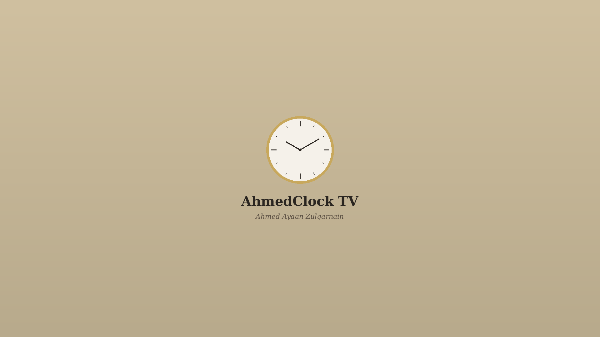

# AhmedClock TV v2

A beautiful analog wall clock app for **LG webOS Smart TVs**, built with vanilla HTML, CSS, and JavaScript. Designed for full-screen 1920×1080 display.



## Features

- **Elegant Analog Clock** — smooth sweep second hand with 60-tick face and hour numerals
- **Digital Panel** — shows current date and simulated ambient temperature
- **World Clock** — live time display for 11 major cities, switchable via TV remote or click
- **Top Bar** — always-visible digital time in 12-hour format
- **Splash Screen** — branded intro screen with animated loader on app launch
- **TV Remote Support** — full keyboard/remote navigation including LG Back key (keyCode 461)
- **Timezone Aware** — main clock fixed to GMT+6 (Dhaka); world clock supports any UTC offset
- **Performance Optimized** — uses `requestAnimationFrame` for smooth animation; pauses when app is hidden

## World Clock Cities

| City        | Timezone   |
|-------------|------------|
| Berlin      | GMT+2      |
| New York    | GMT-4      |
| Los Angeles | GMT-7      |
| Dubai       | GMT+4      |
| Tokyo       | GMT+9      |
| Singapore   | GMT+8      |
| Sydney      | GMT+10     |
| Riyadh      | GMT+3      |
| Istanbul    | GMT+3      |
| Kolkata     | GMT+5:30   |
| Toronto     | GMT-4      |

## Project Structure

```
AhmedClockTV/
├── index.html                              # Main app entry point
├── appinfo.json                            # webOS app manifest
├── css/
│   └── style.css                          # Full-HD layout & styling
├── js/
│   └── clock.js                           # Clock engine & world clock logic
├── icon.png                               # App icon (small)
├── largeIcon.png                          # App icon (large)
├── splash.png                             # Splash screen background
└── com.ahmedmusa.clock.ahmedclocktv_2.0.0_all.ipk  # Packaged webOS app
```

## Installation on LG webOS TV

### Using the `.ipk` Package (Recommended)

1. Enable **Developer Mode** on your LG TV:
   - Go to `Settings > General > About This TV`
   - Press `1-1-1-1-1` on the remote to open Developer Mode
   - Sign in with your LG Developer account

2. Install the [webOS Dev Manager](https://webosose.org/tools/ares-webos-studio/) or use the `ares-cli` tool

3. Deploy the app:
   ```bash
   ares-install com.ahmedmusa.clock.ahmedclocktv_2.0.0_all.ipk
   ```

4. Launch from the TV's app list

### Building from Source

Requires the [webOS CLI tools](https://webostv.developer.lge.com/develop/tools/cli-installation):

```bash
ares-package .
ares-install com.ahmedmusa.clock.ahmedclocktv_2.0.0_all.ipk
```

## App Info

| Field       | Value                                  |
|-------------|----------------------------------------|
| App ID      | `com.ahmedmusa.clock.ahmedclocktv`     |
| Version     | `2.0.0`                                |
| Vendor      | Ahmed Musa                             |
| Resolution  | 1920×1080                              |
| Type        | Web App (webOS)                        |
| Min Memory  | 20 MB                                  |

## Developer

**Ahmed Musa**
webOS TV App Developer

---

*Designed and built for LG Smart TVs running webOS.*
